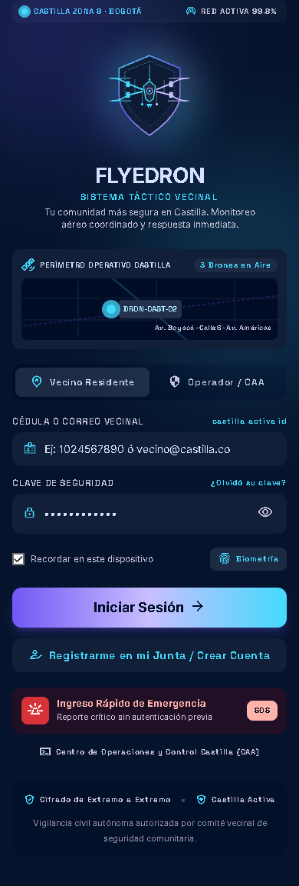
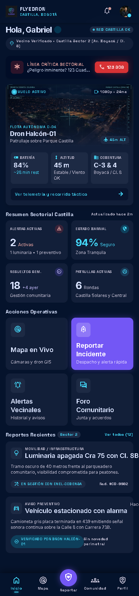
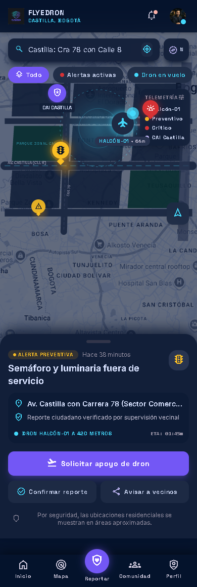
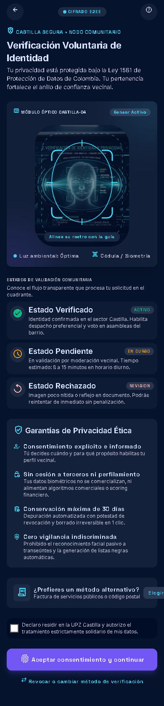
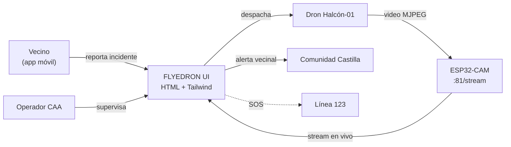

<div align="center">



**Vigilancia civil autónoma con drones, reportes en tiempo real y comunidad conectada.**

<br>


<br>






</div>

---

<a id="toc"></a>

##  Tabla de contenido

-  [¿Qué es FLYEDRON?](#que-es)
-  [Características](#caracteristicas)
-  [Pantallas](#pantallas)
-  [Sistema de diseño: AeroGuard Castilla](#diseno)
-  [Arquitectura](#arquitectura)
-  [Estructura del proyecto](#estructura)
-  [Inicio rápido](#inicio)
-  [Conectar el dron (ESP32-CAM)](#esp32)
-  [Despliegue en Firebase](#firebase)
-  [Privacidad](#privacidad)
-  [Roadmap](#roadmap)
-  [Créditos](#creditos)

---

<a id="que-es"></a>

##  ¿Qué es FLYEDRON?

**FLYEDRON** es un prototipo de **sistema de seguridad comunitaria** pensado para el barrio **Castilla (Zona 8, Bogotá)**. Conecta a vecinos verificados, comités barriales y una flota de **drones de patrullaje** en una sola app móvil:

> Los vecinos reportan →  un dron inspecciona en minutos →  la comunidad se entera al instante.

El proyecto contiene el **diseño UI/UX completo** (generado con Stitch) en HTML + Tailwind, con interacciones reales como captura de rostro por cámara y visor de transmisión en vivo desde un **ESP32-CAM**.

---

<a id="caracteristicas"></a>

##  Características

| | Función | Descripción |
|---|---|---|
|  | **Inicio de sesión dual** | Acceso como *Vecino Residente* u *Operador / CAA*, con opción biométrica |
|  | **Verificación de identidad** | Captura facial con la cámara del dispositivo, en voluntario y con estados *Verificado / Pendiente / Rechazado* |
|  | **Panel principal** | Resumen sectorial: alertas activas, estado del barrio, patrullas y vuelo del dron en curso |
|  | **Mapa táctico** | Capas de alertas, dron en vuelo, reportes ciudadanos y puntos CAI con ETA del dron |
|  | **Alertas sectoriales** | Filtro por prioridad (críticas / preventivas) y asignación de dron |
|  | **Reportar incidente** | Robo, sospechoso, luminaria, médica, convivencia… con opción de **despachar inspección de dron** |
|  | **Comunidad** | Contactos de emergencia, asambleas y muro de la Junta de Acción Comunal |
|  | **Centro de vigilancia** | Transmisión en vivo, telemetría (batería, altitud, velocidad, GPS), foco LED, sirena y captura de foto |
|  | **SOS 123** | Acceso rápido de emergencia sin autenticación previa |

---

<a id="pantallas"></a>

##  Pantallas

| # | Pantalla | Carpeta |
|:-:|---|---|
| 1 |  Bienvenida e inicio de sesión | [`1._bienvenida_e_inicio_de_sesi_n`](./1._bienvenida_e_inicio_de_sesi_n) |
| 2 |  Verificación de identidad y privacidad | [`2._verificaci_n_de_identidad_y_privacidad`](./2._verificaci_n_de_identidad_y_privacidad) |
| 3 |  Inicio / panel principal | [`3._inicio_panel_principal`](./3._inicio_panel_principal) |
| 4 |  Mapa de seguridad Castilla | [`4._mapa_de_seguridad_castilla`](./4._mapa_de_seguridad_castilla) |
| 5 |  Alertas sectoriales | [`5._alertas_sectoriales`](./5._alertas_sectoriales) |
| 6 |  Reportar incidente | [`6._reportar_incidente`](./6._reportar_incidente) |
| 7 |  Comunidad Castilla | [`7._comunidad_castilla`](./7._comunidad_castilla) |
| 8 |  Centro de vigilancia | [`8._centro_de_vigilancia`](./8._centro_de_vigilancia) |

<details>
<summary><b> Ver capturas en grande</b></summary>

<br>

<div align="center">

| Bienvenida | Verificación | Panel | Mapa |
|:-:|:-:|:-:|:-:|
|  |  |  |  |

</div>

</details>

La navegación inferior flotante tiene 6 destinos: **Inicio · Mapa · Alertas · Reportar · Comunidad · Vigilancia**.

---

<a id="diseno"></a>

##  Sistema de diseño: AeroGuard Castilla

Estética **tactical-futurist**: fondos azul marino profundo, telemetría luminosa y alta legibilidad en situaciones de emergencia. La especificación completa está en [`aeroguard_castilla/DESIGN.md`](./aeroguard_castilla/DESIGN.md).

### Paleta

| Rol | Color | Hex |
|---|:-:|---|
| Fondo / canvas |  | `#07152F` |
| Superficie / paneles |  | `#102448` |
| Primario (acciones) |  | `#7357F5` |
| Secundario (telemetría / dron) |  | `#20C7E8` |
| Crítico / SOS |  | `#EF4444` |
| Advertencia / preventivo |  | `#F59E0B` |
| Seguro / verificado |  | `#10B981` |

### Tipografía

- **Inter** → interfaz, textos y notificaciones
- **Space Grotesk** → telemetría, badges, coordenadas (`ALT 42M`, `BAT 89%`)
- **Material Symbols Outlined** → iconografía

### Componentes clave

-   **Botón SOS** con pulso ambiental y *hold* de 1.5 s para evitar activaciones accidentales
-   **Badges de estado** tipo píldora con punto parpadeante en alertas críticas
-   **Navegación flotante** con *glassmorphism* (`blur 16px`) y glow cian en el ítem activo
-   **Tarjetas de dron** con visor 16:9 y HUD cian

---

<a id="arquitectura"></a>

##  Arquitectura



**Stack actual**

-   Frontend estático: **HTML5 + Tailwind CSS (CDN) + JavaScript vanilla**
-   `getUserMedia` para captura facial → imagen en **Base64** (`window.capturedFaceBase64`)
-   Visor de video por flujo MJPEG de **ESP32-CAM**
-   Hosting en **Firebase** (proyecto `sistema-vecinal-flyedron`)
-   Servidor local en **PowerShell** (`serve.ps1`)

---

<a id="estructura"></a>

##  Estructura del proyecto

```text
flyedron/
├── 1._bienvenida_e_inicio_de_sesi_n/        # code.html + screen.png
├── 2._verificaci_n_de_identidad_y_privacidad/ # code.html + screen.png
├── 3._inicio_panel_principal/               # code.html + screen.png
├── 4._mapa_de_seguridad_castilla/           # code.html + screen.png
├── 5._alertas_sectoriales/                  # code.html
├── 6._reportar_incidente/                   # code.html
├── 7._comunidad_castilla/                   # code.html
├── 8._centro_de_vigilancia/                 # code.html
├── aeroguard_castilla/
│   └── DESIGN.md                            # Sistema de diseño
├── flyedron_community_security_tactical_drone_system/
│   └── code.html                               # Pantalla de bienvenida (versión inicial)
├── public/
├── index.html                               # Redirige a la verificación de identidad
├── iniciar_servidor.bat                     # Lanzador rápido (Windows)
├── serve.ps1                                # Servidor local en PowerShell
├── docs/                                       # Banner e iconos SVG del README
├── firebase.json
└── .firebaserc
```

---

<a id="inicio"></a>

##  Inicio rápido

### Paso 1 · Clonar el repositorio

```bash
git clone https://github.com/TU_USUARIO/flyedron.git
cd flyedron
```

### Paso 2 · Levantar el servidor local

> La captura de rostro usa la cámara, que **solo funciona en `localhost` o HTTPS**. Por eso no basta con abrir el HTML con doble clic.

<details open>
<summary><b>Windows (recomendado)</b></summary>

Doble clic en **`iniciar_servidor.bat`**. Se abre automáticamente `http://localhost:5500`.

(Si el puerto 5500 está ocupado, usa el `8080`.)

</details>

<details>
<summary><b>Linux / macOS</b></summary>

```bash
python3 -m http.server 5500
```

Luego abre  http://localhost:5500

</details>

<details>
<summary><b>Node.js</b></summary>

```bash
npx serve -l 5500 .
```

</details>

### Paso 3 · Explorar

Entra a cualquiera de las 8 pantallas, por ejemplo:

```text
http://localhost:5500/1._bienvenida_e_inicio_de_sesi_n/code.html
```

---

<a id="esp32"></a>

##  Conectar el dron (ESP32-CAM)

Las pantallas **Inicio** y **Centro de vigilancia** muestran el video del dron desde un ESP32-CAM. La URL por defecto es:

```text
http://192.168.1.50:81/stream
```

Para usar tu propio módulo:

1. Enciende el ESP32-CAM y conéctalo a la **misma red Wi-Fi** que tu computador.
2. Anota su IP (por ejemplo, desde el monitor serial).
3. En **Centro de vigilancia**, escribe la nueva URL en el campo de configuración de IP y pulsa **Reconectar**.
4. Para dejarla fija, cambia `src="http://192.168.1.50:81/stream"` en `3._inicio_panel_principal/code.html` y `8._centro_de_vigilancia/code.html`.

---

<a id="firebase"></a>

##  Despliegue en Firebase

```bash
npm install -g firebase-tools
firebase login
firebase deploy --only hosting
```

El proyecto ya está configurado con el ID `sistema-vecinal-flyedron` (ver [`.firebaserc`](./.firebaserc)). Los archivos `*.bat`, `*.ps1` y ocultos se excluyen del despliegue automáticamente.

---

<a id="privacidad"></a>

##  Privacidad

FLYEDRON está diseñado alrededor de la confianza vecinal:

-   Verificación de identidad **voluntaria**
-   Marco de protección de datos de la **Ley 1581 de Colombia**
-   Indicadores de cifrado de extremo a extremo en la interfaz
-   Las ubicaciones residenciales se muestran en **áreas aproximadas**
-   Vigilancia civil autorizada por el comité vecinal de seguridad

>  Este repositorio es un **prototipo de interfaz**. Antes de usarlo con datos reales de personas (rostros, ubicaciones, cédulas) hay que implementar un backend con autenticación, cifrado y almacenamiento seguro.

---

<a id="roadmap"></a>

##  Roadmap

- [x]  Sistema de diseño AeroGuard Castilla
- [x]  8 pantallas móviles diseñadas
- [x]  Captura facial con `getUserMedia`
- [x]  Visor de video ESP32-CAM
- [x]  Configuración de hosting en Firebase
- [ ]  Autenticación real (Firebase Auth)
- [ ]  Base de datos de reportes y alertas en tiempo real
- [ ]  Mapa interactivo con GIS real
- [ ]  Notificaciones push a vecinos
- [ ]  Detección con visión por computador
- [ ]  Telemetría real del dron (batería, GPS, altitud)
- [ ]  Empaquetado como PWA

---

<a id="creditos"></a>

##  Créditos

- Diseño de interfaces generado con **Stitch**
- Desarrollo e integración: **[@TU_USUARIO](https://github.com/TU_USUARIO)**
- Pensado para la comunidad de **Castilla, Bogotá** 

<div align="center">

<br>

**Hecho con  y  en Bogotá, Colombia**

 Si te gustó el proyecto, ¡dale una estrella al repo!

</div>
